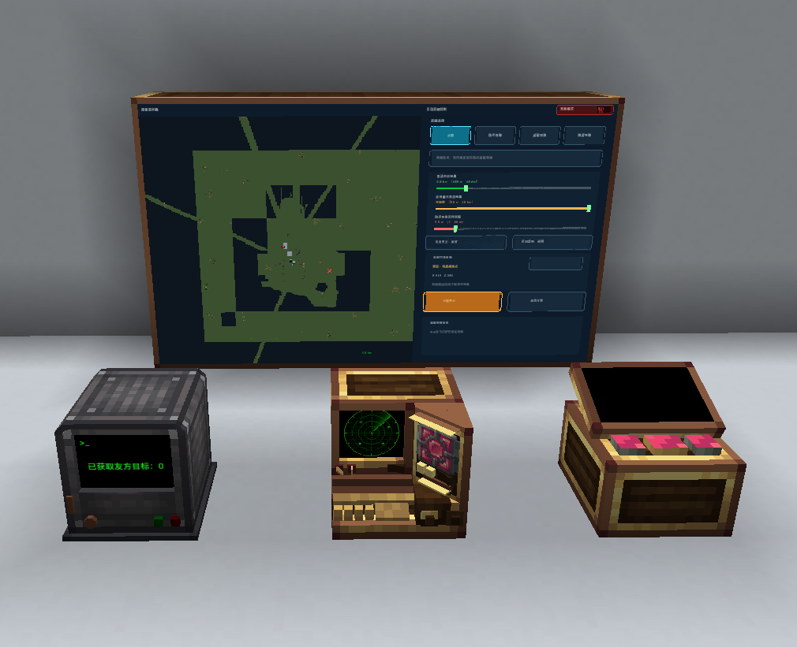
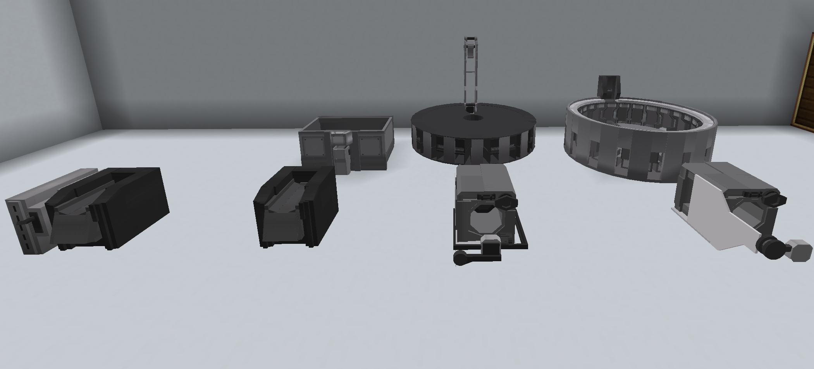
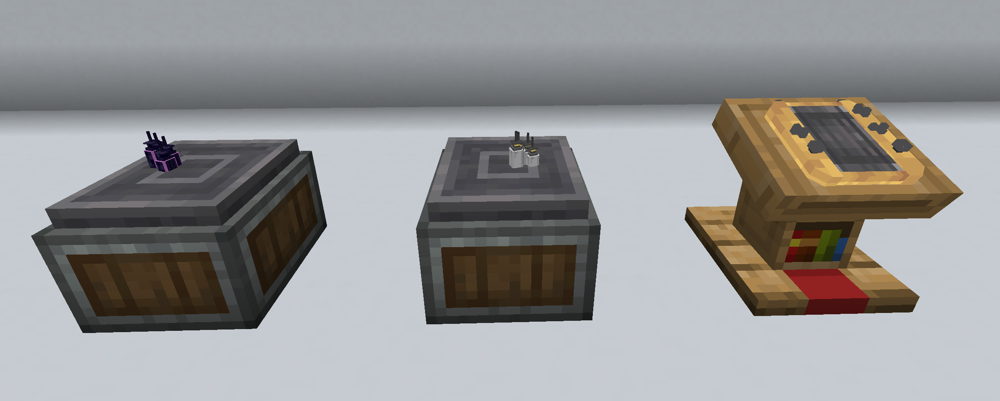
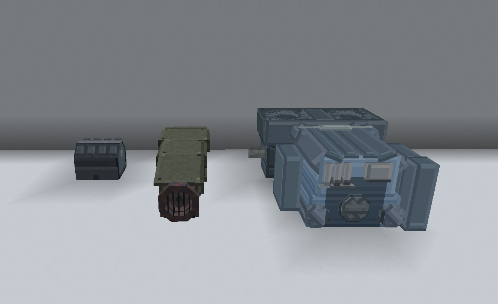
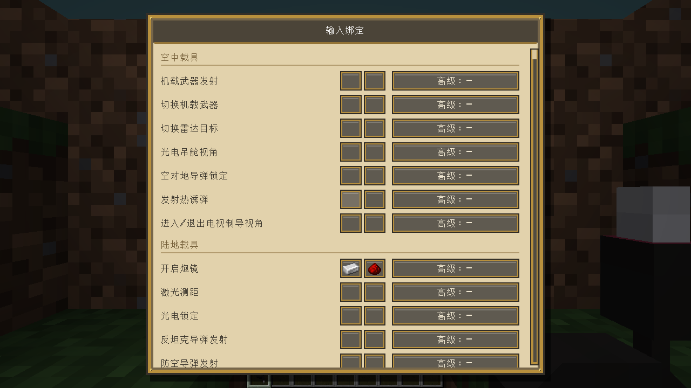
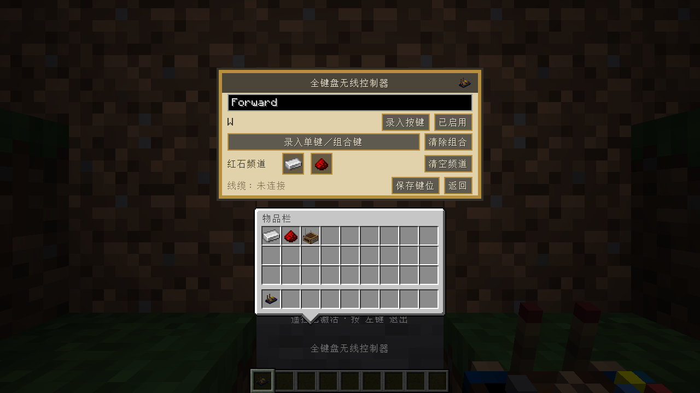

<div align="center">

# Create: Fire Control

**机械动力：综合火控**

面向 Minecraft 1.21.1 / NeoForge 的载具火控与武器系统模组

[](#)
[](#)
[](#)
[](LICENSE)

</div>

Create: Fire Control 为 Create、Sable 与 Create Aeronautics 生态提供一套完整的载具火控链：以火控计算机为核心，把物理轴承构成的方向机、高低机、炮镜、光电吊舱、雷达、火炮、导弹与遥控武器站串联起来，用于坦克、装甲车辆、固定炮台和航空器。

*Create: Fire Control is a vehicle fire-control and weapon-systems mod for Minecraft 1.21.1 / NeoForge, built around Create, Sable and Create Aeronautics.*

> **运行环境**：Minecraft 1.21.1 / NeoForge 21.1.230+。必需前置：Create 6.0.10.x、Sable 2.0.6.x、Create Aeronautics / Simulated 1.2.1.x 或 1.3.0–1.3.2、GeckoLib 4.7+、面包军火库 2.7.1+。完整版本、可选前置、专项兼容与推荐光影见[版本与依赖](#版本与依赖)。

## 主要功能

### 火控与稳定

- 基于 Sable 物理轴承的双向稳定：方向机与高低机独立保持世界空间指向，不受车体晃动影响
- 头瞄、真实炮口瞄准、炮口补偿、第三人称瞄准点与光电锁定
- 方向机左右限位、中心标定、物理俯仰限位、轴承偏移与应力驱动控制
- 多炮塔分组、逐台轴承设置、结构预览与绑定设备高亮
- 激光测距与下坠抬炮角补偿，支持 Voxy 远景 LOD 地形
- 绑定座椅与遥控授权，支持 Sable 蓝图保存与迁移

### 观瞄与传感器

- 火炮瞄具与可缩放视野、炮镜偏移配置
- 热成像后处理，兼容 Photon 等渲染环境
- 光电吊舱视角、吊舱模型姿态控制与光电锁定
- 雷达扫描与雷达锁定、地面雷达、雷达告警接收机（RWR）
- IFF 敌我识别应答机
- 连接显示器、显示器控制台与自动防御显示器

### 武器系统

- CBC / CBC Neo Warfare 火炮、炮座与炮闩兼容
- MZ、AZ 与尾仓装弹机，Type 10 专用炮闩与自动装填
- APFSDS 穿甲弹、终端弹道学与多面体装甲弹孔
- 面包军火库导弹、炸弹、火箭弹、挂架与机载雷达联动
- 空空、空地、反辐射、巡航、弹道导弹与防空拦截
- 红外格斗弹、主动雷达寻的、比例制导与引信保险
- 干扰弹、自动防御显示器与遥控武器站
- 机载武器第三人称观察视角，第一/第三人称三维落点预测投弹圈

### 载具与动力

- 燃气轮机、99A 柴油机与虎式汽油机，含独立音效与控制界面
- 全键盘无线控制器、无线信号处理器、讲台控制器
- 键盘与鼠标独立输入、组合键、无线红石输出与终端映射
- Drive By Wire 线缆输出兼容（可选）
- Create 遥控器、操作座椅与蓝图系统兼容

### 装甲与伪装

- 内置 [CopyPoly 1.9.1](docs/COPYPOLY_INTEGRATION.md)：伪装多面体装甲、世界内编辑器、材质伪装与自定义顶点/连线/曲面拓扑
- [多面体装甲](docs/POLYHEDRAL_ARMOR.md)按实际体积继承伪装材质的硬度与韧性，生成可编辑的真实弹孔
- 可选全局等效装甲：按命中位置与弹道换算穿透距离，默认关闭

## 预览

### 模型与设备

| 主要设备与显示器 | 火炮与装填机 |
| --- | --- |
|  |  |
| 弹药箱与控制器 | 动力与弹药 |
|  |  |

### 界面

| 火控按键配置 | 全键盘无线控制器 |
| --- | --- |
|  |  |

## 版本与依赖

当前模组版本：**1.0.4**  
游戏版本：**Minecraft 1.21.1**  
加载器：**NeoForge 21.1.230 或更高**

### 必要前置（缺一不可）

| 模组 | 版本要求 | 说明 |
| --- | --- | --- |
| Minecraft | **1.21.1** | 仅支持 1.21.1，不兼容 1.21.2+ |
| NeoForge | **21.1.230+** | 构建与验收版本为 21.1.230 |
| Create | **6.0.10.x** | 要求 `[6.0.10, 6.0.11)` |
| Sable | **2.0.6.x** | 要求 `[2.0.6, 2.0.7)` |
| Create Aeronautics | **1.2.1.x 或 1.3.0–1.3.2** | 要求 `[1.2.1,1.2.2)` 或 `[1.3.0,1.3.3)` |
| Simulated | **1.2.1.x 或 1.3.0–1.3.2** | 与 Create Aeronautics 使用同一版本范围 |
| GeckoLib | **4.7+** | 构建使用 4.9.1 |
| 面包军火库（Mianbao's Modern Warfare） | **2.7.1+** | 导弹、炸弹、火箭弹、挂架与发射器 |

### 可选前置（不装可启动，对应功能关闭）

| 模组 | 版本要求 | 启用的功能 |
| --- | --- | --- |
| Create: Interiors | **0.6.1.x** | 座椅、内饰与绑定候选 |
| Drive By Wire | **0.3.0+** | 无线控制器线缆输出 |
| Create Big Cannons（CBC） | **5.11.6–5.11.7** | 火炮、炮座、炮闩与炮弹基础兼容 |
| CBC Neo Warfare | **0.0.6v+mc.1.21.1-neoforge** | 现代火炮、炮闩、弹药与武器站 |
| CBC At | **0.1.4c-1.21.1+** | 重型机炮、专用弹箱与快装炮闩 |
| CBC Enhanced Shells | **1.2.2+** | 增强弹种与装药属性（已验证 1.4.0） |
| Yuushya Modelling | **2.4.1.x** | 建模炮管、后坐动画与模型兼容 |
| Sable Schematic API | **0.4.0+** | 火控绑定与轴承设置随蓝图保存 |
| Touhou Little Maid | **1.4.2+** | 女仆装填与火炮操作（已验证 1.5.3） |

### 专项兼容（已单独适配，非必需）

| 模组 | 已验证版本 | 兼容内容 |
| --- | --- | --- |
| Create: Flight Control | 0.8.2 / 0.8.3 | 鼠标飞控 HUD、红外导引圈与武器观察视角 |
| Create: Tweaked Controllers | 1.21.1-1.2.7 | 高级遥控器模型与输入接管 |
| CBC Military Supplement（Shaolib） | 3.0.0（2.1.4 保留旧实体分支） | 单管/双联装弹道、装填读取与提前量 |
| CBC Terminal Ballistics | 0.3.5-neoforge | 多面体装甲穿透与终端弹道 |
| Copycats+ | 3.0.11 | CBC Terminal Ballistics 的运行前置 |
| Autogun Revolution | 已验证 | 高速 APFSDS 的首 tick 增速与提前量 |
| qModeling | 2.0.6rp | 光影热成像中的加速模型显示 |
| Colorwheel | 1.3.2 | Flywheel 实例化模型与炮镜剔除兼容 |
| Voxy | 0.3.8（neo-voxy） | 远景 LOD 瞄准、雷达遮挡与热成像 |
| Xaero's World Map | 1.45 | 连接显示器地图 |
| Photon | 1.21.1 对应版本 | 热成像 + Voxy 专用直出色路径 |
| Sable Photomancy / Synaxis | 可选 | 焊接图与无接触约束 |
| Effortless | 3.4.0 | 多面体装甲放置粒子兼容 |

### 推荐光影与渲染组合

推荐使用 **Iris 1.8.14-beta.1 + Sodium（1.21.1 对应版本）+ Photon + Voxy 0.3.8**：

- **Photon** 系列光影会启用火控专用的热成像/Voxy 直出色路径，远景与热成像兼容性最好。光影包名需以 `Photon` 开头，支持版本或汉化后缀，例如 `Photon-Shaders_..._zh_CN.zip`。
- 其他 Iris 光影仍可运行，但热成像会走通用 Iris 旁路，不会启用 Photon/Voxy 专用路径；这些光影未做专项适配，需自行测试。
- 不安装光影时，热成像使用原生固定光照管线。
- 使用 qModeling 时，建议同时使用 Flywheel 1.0.6 + Colorwheel 1.3.2。

> CopyPoly 已内置在发行包中，**不要**再安装独立的 CopyPoly JAR，否则会重复注册 Mod ID。

## 安装

1. 安装 Minecraft 1.21.1 与 NeoForge 21.1.230（或更高版本）。
2. 将 Create 6.0.10.x、Sable 2.0.6.x、Create Aeronautics / Simulated（1.2.1.x 或 1.3.0–1.3.2）、GeckoLib 4.7+ 与面包军火库 2.7.1+ 放入 `mods/`。
3. 将 `create-fire-control-1.0.4.jar` 放入 `mods/`。
4. 按“可选前置”与“专项兼容”表加入需要的模组；未安装的可选模组不会阻止启动。

## 快速上手

1. 制作并放置**火控计算机**。
2. 右键打开界面，绑定方向机、高低机、炮手座椅与火炮。
3. 坐上绑定座椅，开启头瞄或进入炮镜；使用激光测距获得弹道补偿。
4. 需要远程操作时，制作**无线信号处理器**与**全键盘无线控制器**，右键绑定后配置按键。
5. 需要雷达或武器管理时，接入**连接显示器**并绑定雷达、导弹与挂架设备。

完整操作说明见 [文档目录](docs)。常用入口：

- [火控输入与组合键](docs/FIRE_CONTROL_INPUTS_2026-10-12.md)
- [激光测距与抬炮补偿](docs/LASER_RANGEFINDER_2026-10-08.md)
- [结构预览与逐台轴承设置](docs/STRUCTURE_PREVIEW_2026-11-13.md)
- [武器第三人称视角](docs/WEAPON_VIEW_2026-11-06.md)
- [遥控器公开 API](docs/REMOTE_CONTROLLER_API.md)

## 构建

本仓库不重新分发第三方模组 JAR。请先按 [依赖说明](docs/DEPENDENCIES.md) 准备本地 `libs/`，然后执行：

```powershell
.\gradlew.bat build
```

完整发行包输出到 `build/libs/create-fire-control-<版本>.jar`。

## 许可证

本项目采用**混合许可**：

- **火控原创部分**：保留所有权利（All Rights Reserved）。源码公开用于查阅与构建，不授予复制、修改、再分发或商业使用许可。详见 [LICENSE](LICENSE)。
- **CopyPoly 1.9.1**：MIT，Copyright (c) 2026 caca。源码位于 [third_party/copypoly](third_party/copypoly)，完整许可证为 [third_party/copypoly/LICENSE](third_party/copypoly/LICENSE)。
- **Drive-By-Wire 派生代码与材质**：MIT，Copyright (c) 2023 endalion。完整许可证与适用范围见 [META-INF/licenses/drivebywire-model-MIT.txt](src/main/resources/META-INF/licenses/drivebywire-model-MIT.txt)。
- **其他第三方内容**：保留各自许可，详见 [THIRD_PARTY_NOTICES.md](THIRD_PARTY_NOTICES.md)。

MIT 例外仅适用于上述明确标识的组件，不会因为与火控代码打包在同一 JAR 或资源命名空间中而改变。虎式 I 发动机音效另有独立来源说明，不属于上述许可范围，详见 [音效 NOTICE](src/main/resources/assets/create_fire_control/sounds/engine/tiger_i/NOTICE.md)。

## 致谢

- [CopyPoly](third_party/copypoly) — caca（MIT）
- Drive-By-Wire — endalion（MIT 部分）
- Create、Sable、Create Aeronautics、Simulated、GeckoLib、Create Big Cannons、面包军火库及其附属模组的作者与社区

## 链接

- [依赖与开发环境](docs/DEPENDENCIES.md)
- [CopyPoly 整合说明](docs/COPYPOLY_INTEGRATION.md)
- [多面体装甲](docs/POLYHEDRAL_ARMOR.md)
- [无线控制器 API](docs/REMOTE_CONTROLLER_API.md)
- [问题反馈](https://github.com/BaiCaiYu1123/Create-Fire-Control/issues)
