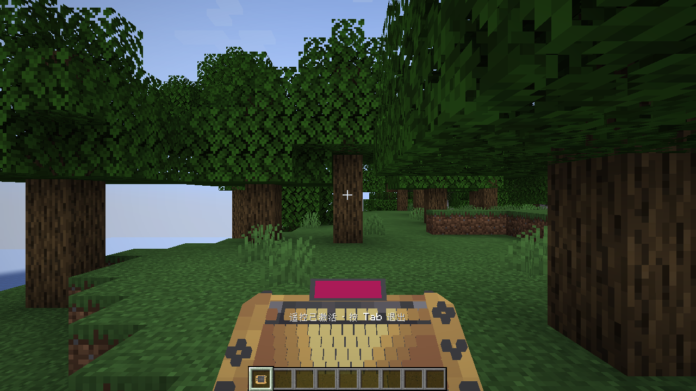
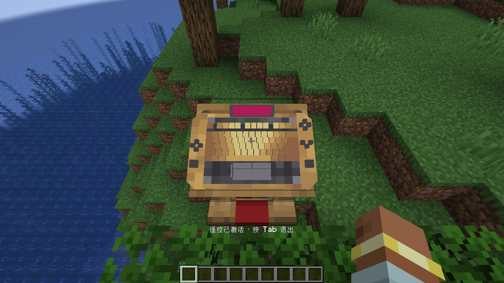
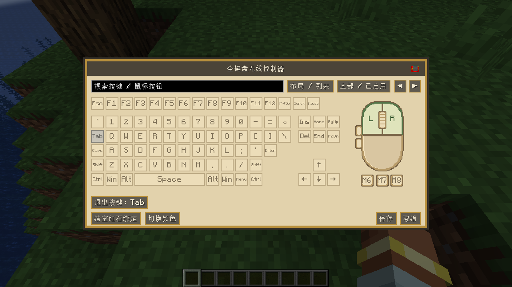
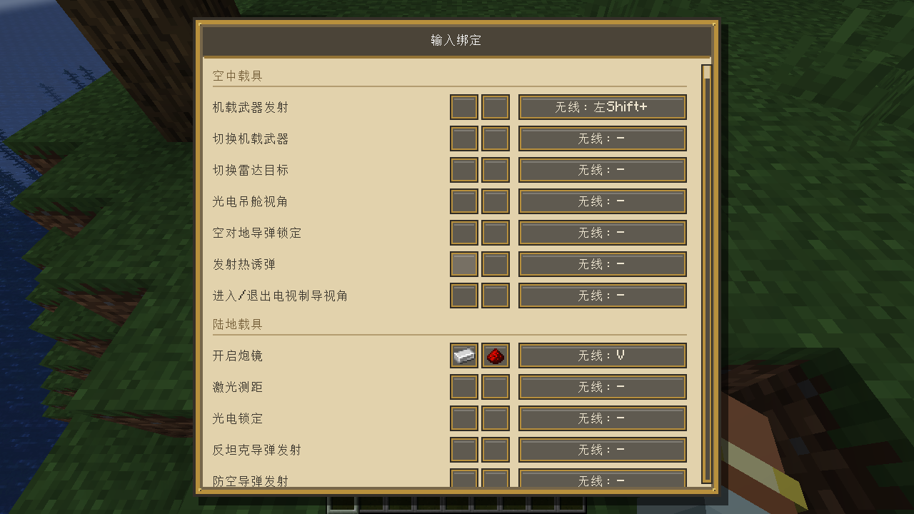

# 遥控器 0.9.1 修订

按用户最新要求，版本改为 **0.9.1**。

## 持握与动画

启用后的遥控器继续水平居中，按最新参考图将手持高度从 `-0.76` 上移至 `-0.63`，主手、左利手和副手使用同一高度；物品及手持缩放保留。

居中移动使用与高级遥控器相同的指数追随参数 `0.2`，再对插值做平滑处理，形成慢、快、慢的阻尼过渡。

默认状态保持原动画最后一帧。进入操控从最后一帧倒放展开，完成后切换为独立键帽模型；退出后从当前姿态正放收合，再回到默认持握位置。按键下压和航空学打字机音效保留。

有效按键使用听者相对、无距离衰减的声音实例，左右声道保持居中，不随玩家位置或朝向偏移。激活一次播放航空学打字机进入使用时实际调用的 `Create CONTROLLER_PUT` 音效；退出不播放音效。

## 切换颜色

配置页“清空红石绑定”右侧添加“切换颜色”。循环选择原色、红黄、紫绿、蓝红，标题栏物品图标预览当前选择，点击保存后写入遥控器物品数据。取消保留原配色。

用户提供的三张 32×32 PNG 原样用于主体、独立键帽和展开／收合动画；每种配色的两个模型阶段共用一张贴图。颜色也随讲台存档、取回及 Sable 蓝图保留，未知颜色值回退原色。

## 讲台

- 手持遥控器右键空讲台放置；有书的讲台不被替换。
- 空手右键进入操控，潜行右键取回。手持另一只本模组遥控器潜行右键可以交换。
- 按用户后续要求恢复讲台动画：默认收合，进入操控倒放展开，退出正放收合；中途退出从当前姿态继续。输入同步不会重新开始动画。
- 讲台遥控器最终使用 `1.0` 缩放，展开时 16 像素的左右宽度与讲台齐平，比此前 `0.9` 再放大约 11%。向讲台前方移动 `0.13` 方块并降低 `0.085` 方块；该调整仅在讲台渲染器中应用，物品图标和手持大小保留。
- 生存放置消耗一只遥控器，讲台朝向保留。取回、破坏或失去操控资格时停止输出。
- 使用距离与高级遥控器相同：方块交互距离属性的 0.4 倍。一台讲台遥控器同时只允许一名玩家使用。
- 放置、世界保存和取回保留原物品的频道、组合键、身份和终端连接。讲台中的键帽与操控状态同步给观察者。
- Sable 蓝图保存讲台和终端时，重映射遥控器身份及终端连接，保留频道与组合键。

## 组合键录入

火控计算机录入组合键时，按住第一个键立即显示其名称和 `+`，例如 `左 Shift+`；按住第二个键后显示完整组合，全部松开完成绑定。Esc 清空。遥控器配置页使用同样的临时预览。

## 第三方模组接口

公开入口为 `com.hooya.stabilizedturret.api.remote.RemoteControllerApi`，提供类型明确的物品配置、组合键、配色、终端配对／解绑、线缆连接、16 项火控映射、发动机终端、讲台存取与交换、纯逻辑操控会话和自定义动作注册。接口的纯逻辑会话不会启用客户端操控、模型动画、键帽动画或遥控器音效。

接口源码随主 JAR 提供，另生成 `build/libs/create-fire-control-0.9.1-controller-api-sources.jar`。依赖配置、线程要求、心跳、全部方法及使用示例见 [遥控器公开接口](REMOTE_CONTROLLER_API.md)。

有 Drive By Wire 的完整服务端、没有该可选依赖的服务端、外部模组针对成品 JAR 的编译，以及客户端无动画／声音检查均通过；也验证了自定义回调注销、回调内部停止与失去心跳后的输出清理。之前的原生输入、讲台、发动机和 Sable 蓝图验收保留。

## 错误报告修复

报告 `错误报告-2026-10-12_21.12.20.zip` 的最早异常是模型注册回调读取 `create_fire_control:keyboard/controller.json` 失败。检查已安装的 9.0 JAR 确认文件存在，SHA256 与交付文件一致。

首次修订将模型注册与资源重载分离，避免模型注册回调依赖全局资源管理器的状态。

修订后，模型注册只从 JAR 内的部件目录登记模型，动画配置通过资源重载回调提供的当前资源管理器读取。这样仍支持资源包覆盖，并避免模型注册时访问旧管理器。

完整整合包随后出现黑紫模型。已安装 JAR 的 SHA256 与交付文件相同，包含全部 98 个键盘资源；Lightspeed 的 `resourceLists/create_fire_control0.9.1-create-fire-control-0.9.1.lsc` 中没有任何 `keyboard` 路径。其默认缓存键仅包含模组、版本和文件名，更新同版本 JAR 后会复用旧索引，将新模型和贴图判成不存在。

已备份 `D:/Game/PCLII/.minecraft/versions/Create航空学/config/lightspeed-common.toml` 并将 `startup.verifyJarHash` 改为 `true`。重启后按实际 JAR SHA256 选择缓存，支持继续使用 0.9.1。需要完全退出并重新启动游戏。隔离客户端也复现了新增配色被旧索引排除的情况，开启同一选项后加载及重载通过。

## 验收与产物

客户端验收包含同版本 Lightspeed `1.21.1-2.0.2hotx2` 的启动和资源重载、全部配色模型及贴图、颜色按钮、声音相对位置与衰减模式、阻尼居中、手持及讲台动画、键帽和 `Shift+` 临时预览。服务端验收包含配色授权保存、讲台动画连续性、讲台保存、无线组合键输出、独占使用、距离退出、取回清理以及蓝图配色和终端重映射。

客户端：`run/controller-client/client/controller-keyboard-result.txt`。
服务端：`run/controller-wire/server/controller-integration-result.txt`。
打包审计：`build/controller-0.9.1-audit.json`。
产物：`build/libs/create-fire-control-0.9.1.jar`。

已安装到 `D:/Game/PCLII/.minecraft/versions/Create航空学/mods/create-fire-control-0.9.1.jar`，SHA256 为 `e89e0e8cf2c061f2badb8725deca4eec70458e0b8e8735c788c6ef9e5d8cac05`。添加 API 和上移手持位置前的 JAR 备份在整合包的 `codex-backups/controller-20261012-233845/`。客户端、两套服务端以及外部调用编译验收均通过；与上一成品逐条比较确认外观资源、键盘物品渲染器和讲台渲染器完全相同，手持仅改变居中后的垂直位置。下一次启动加载新文件并重建资源缓存。

