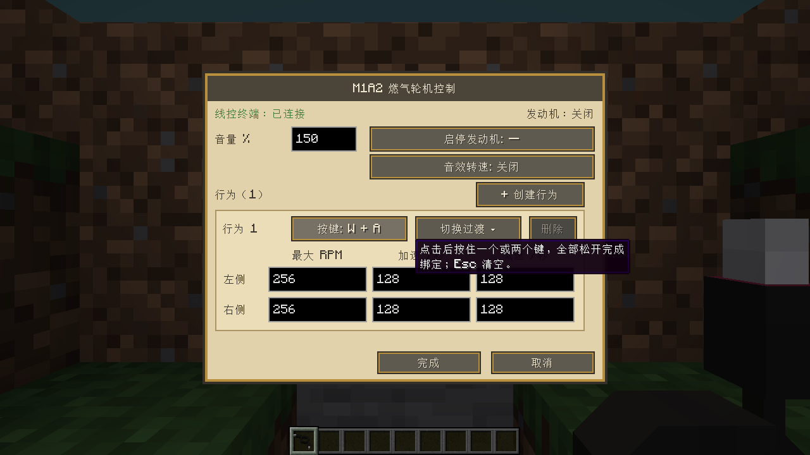
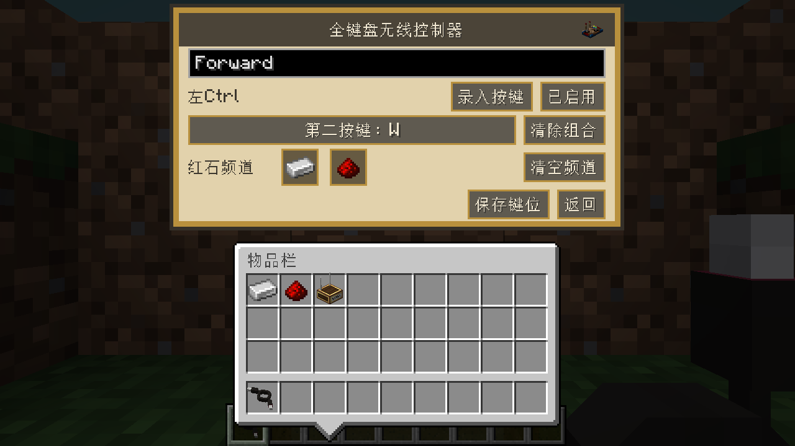

# 新终端、发动机控制与蓝图保存

版本保持 `9.0`。产物：`build/libs/create-fire-control-9.0.jar`。

## 连接与录入

燃气轮机、99A 柴油机和 8 缸汽油机都可以连接新的无线控制器信号处理器：手持机械动力扳手先右键发动机，再右键终端。绑定候选位置沿用现有的提示框，高亮当前已绑定目标。新终端也提供 Create 悬停提示面板和物品说明。

打开发动机设置，点击启停或行为按键按钮后，直接在键盘上按一个键或同时按住两个键；全部松开完成录入，Esc 清空。行为仍保留独立的左右转速、加减速、过渡规则和音效转速设置。原高级终端继续受支持。

火控的新终端映射也改为当前页面直接录入，支持单键和双键组合。新遥控器的“录入按键”和“录入单键／组合键”按钮采用同样的按下、松开流程，Esc 将当前输入改为空白。

## 蓝图

用 Sable 蓝图工具保存时，将发动机或火控计算机、终端和需要保留的线缆目标一起选入蓝图。放置后设备连接会重映射到新终端的位置，而不是保留源载具的绝对坐标。

保存内容包括发动机启停键、行为组合键与参数、火控终端按键映射，以及新终端的线缆连接。8 缸汽油机现已补齐蓝图 mapper 注册。放置的新终端会获得独立身份，避免多个副本共用原终端身份。

## 鼠标接管

新遥控器启用期间，鼠标左、右键始终由遥控器接管，即使没有红石、线缆或功能映射用途，也不会交给游戏进行攻击或使用物品。配置有效用途时仍输出对应控制信号；退出遥控后恢复游戏输入，当前按住的键先等待松开。

## 验收范围

服务端检查三种发动机的直接终端控制、双键启停／行驶、松键停止；通过 Sable Blueprint API 的保存与放置 hooks 检查连接坐标重映射、按键配置保留、终端身份分离、线缆恢复及火控映射保存。

客户端实机检查发动机、火控和遥控器的直接单键／双键录入、Esc 清空、遥控器左右鼠标默认接管，并检查缩放 2 和 3 的页面。未安装线控时仍回归无线红石功能。测试代码和第三方模组均不进入发行包。
