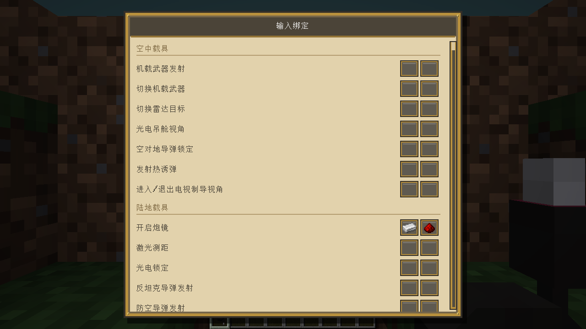
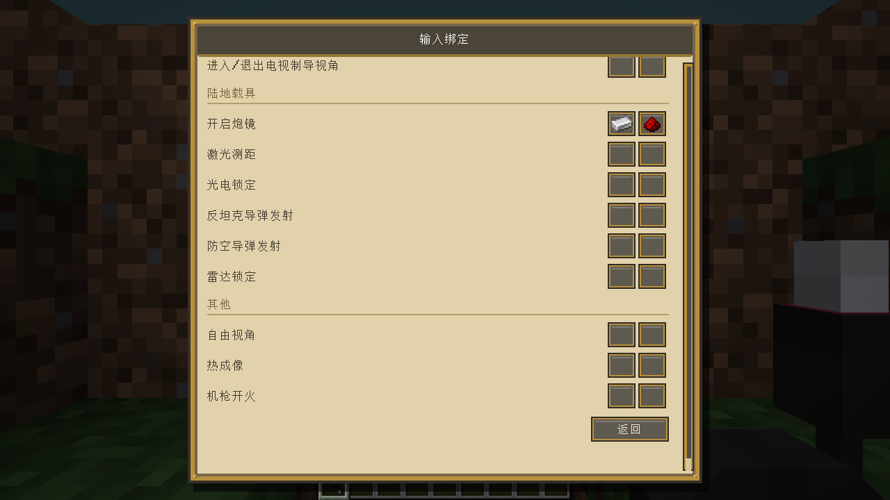
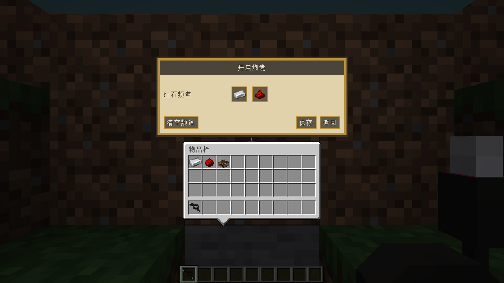
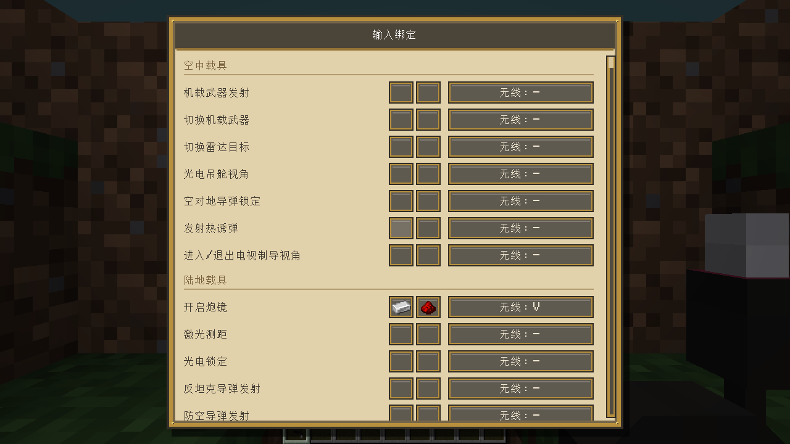
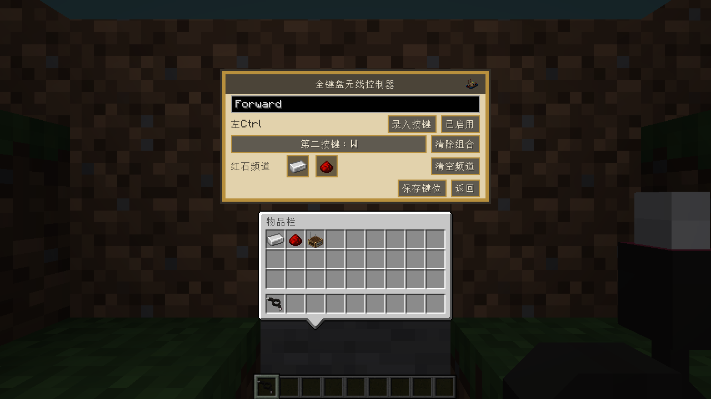

# 火控按键分类、终端映射与双键组合

版本固定为 `9.0`。产物：`build/libs/create-fire-control-9.0.jar`。

## 紧凑按键页

每项动作一行，显示两个物品频率槽。未绑定有效终端时只显示这两个槽；绑定普通、高级或新无线控制器终端后，显示对应终端的按键映射。存在多个终端时，映射按钮另起一行。类别之间有标题和分隔线，列表支持滚轮和右侧滚动条。

| 分类 | 动作 |
| --- | --- |
| 空中载具 | 机载武器发射、切换机载武器、切换雷达目标、光电吊舱视角、空对地导弹锁定、发射热诱弹、进入／退出电视制导视角 |
| 陆地载具 | 开启炮镜、激光测距、光电锁定、反坦克导弹发射、防空导弹发射、雷达锁定 |
| 其他 | 自由视角、热成像、机枪开火 |

点击任意频率槽打开上方配置、下方完整背包的编辑页。点击背包物品，再点击频率槽设置频道；右键槽位清空。点击保存提交两个频率物品，背包物品不会被消耗。

## 新终端直接操作火控

用火控计算机的设备绑定功能绑定“无线控制器信号处理器”。按键页会显示“无线”映射按钮，点击后直接按一个或两个键，全部松开完成录入；Esc 清空该动作的映射。高级遥控器终端仍沿用当前遥控器配置中的按键映射，点击后直接按键录入。

手持新无线控制器右键信号处理器绑定，再右键激活遥控。火控中的有效映射会自动使对应输入生效，不需要额外拉一条线缆。按住型动作保持输出；切换或发射型动作由既有火控逻辑处理。停止遥控、终端失效及删除映射都会清理相应输入和操作者资格。

## 最多两个输入的组合键

新遥控器配置中选择输入，点击“录入按键”或“录入单键／组合键”，直接按一个键或同时按住两个键，全部松开完成；Esc 清空。保存键位，再保存整个遥控器配置。主键和第二键都按住时，主键频道才输出；按下顺序不限，松开任意一个立即停止。“清除组合”恢复单键。

组合键适用于无线红石、线缆和火控直接映射。仍按主键频道接线或映射；第二键是触发条件。第二键若另外配置了独立用途，独立输出仍可使用。当前退出键不能参与控制输出。既有单键配置保持兼容。

每次组合完成时播放航空学打字机的按键音效，长按重复不会连播。

## 验收

输入验收覆盖单键兼容、两键组合、按下顺序、松开任意一键、第二键独立用途和退出键排除。网络往返验收覆盖新增的输入配置状态。

有线控服务端验收覆盖真实无线红石的组合输出、新终端无额外线缆的火控映射、操作者资格、机枪持续输入、解除映射与停止清理。无线控环境回归无线红石和组合键功能。

客户端验收检查无终端与高级／新终端三种布局、分类列表底部、完整背包选频、不消耗物品、组合编辑页，以及界面缩放 2 和 3。测试 fixture 不进入发行包。

发动机的新终端支持、蓝图保存与左右鼠标默认接管见 [发动机终端与蓝图说明](ENGINE_WIRELESS_TERMINAL_2026-10-12.md)。
