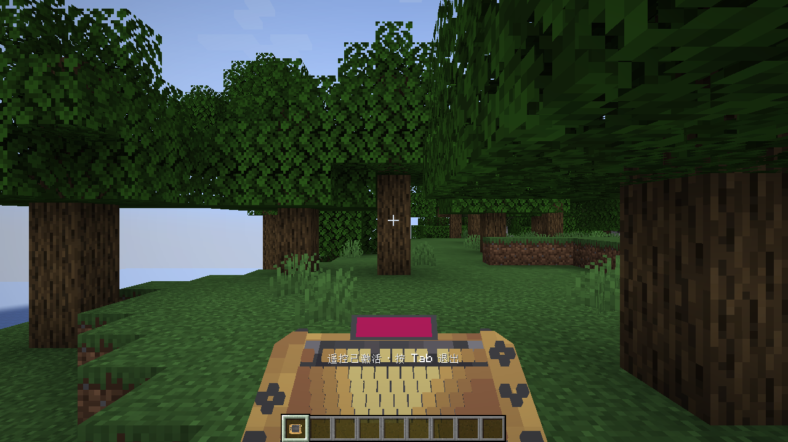
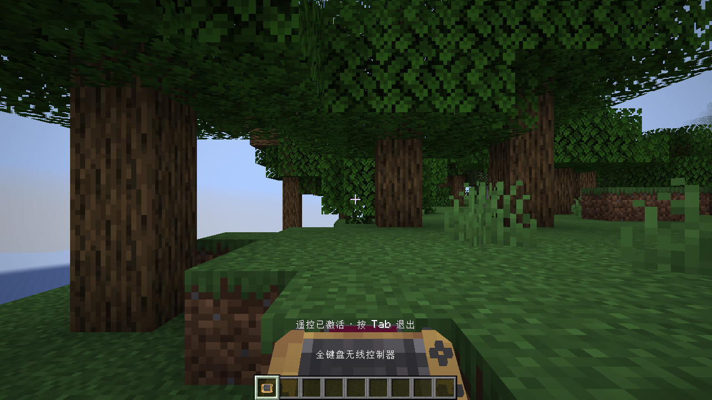

# 遥控器键盘模型

当前版本按用户最新要求为 **0.9.1**。后续修订见 [0.9.1 说明](CONTROLLER_0.9.1_2026-10-12.md)。

使用用户提供的 `键盘.bbmodel` 与 `键盘动画.bbmodel`。原始项目不修改，两个项目的 118 个方块都完整保留。两个贴图仅屏幕像素的颜色不同：使用状态 `(173,27,89)`，动画／闲置状态 `(91,14,47)`。

## 使用效果

- 闲置时保持原动画在 1.5 秒处的最终收合姿态。
- 右键启用后，用原始分组、关键帧和 Bezier 曲线从 1.5 秒倒放到 0 秒；随后立即切换为独立键帽模型，几何和 UV 在切换处一致。
- 手持退出时从当前姿态正放收合；讲台上始终保持展开，进入和退出不播放动画。
- 启用时物品移到画面中央，支持主手、左利手和副手。配置刷新不重启动画。
- 77 个键盘／十字方向键键帽下压 0.3 模型像素。`mb1`、`mb2`、`mb4`、`mb5` 分别对应鼠标左、右和两个侧键，下压 0.08 像素。位移在渲染时按 `/16` 换算为游戏坐标。
- 键帽跟随本地玩家实际按下与松开的输入，包括两个组合键同时按下，以及仍由游戏接收的按键。按键重复事件维持下压；松开单键只恢复该键。退出、窗口失焦与结束会话时清理按下状态。
- 有效控制输入继续播放航空学打字机原按键音。启用期间鼠标左右键继续接管。

## 按用户确认保留的缺失与外观部件

缺少以下键帽的输入仍然可以绑定，但模型不显示其下压：

- 鼠标中键 `mb3` 和鼠标第 6–8 键。
- Insert、Delete、Home、End、Page Up、Page Down。
- Print Screen、Scroll Lock、Pause、Num Lock、数字小键盘全区。
- F13–F25、GLFW 的两个国际键、键盘菜单键。

`Fn` 没有通用的独立 GLFW 键码，保留为外观。`<` 和 `>` 对应逗号、句号两个物理键；左右 Win、Shift、Ctrl、Alt 分别映射，不合并。

侧面 A/B/X/Y、摇杆、肩键、扳机和 Start/Select/Menu 按用户确认作为外观保留。侧面十字键映射四个方向键。通过所属分组区分键盘字母与同名手柄按钮，避免 A/B/X/Y 同时误动两处。

## 资源与验证

转换脚本：`tools/prepare_keyboard_controller.py`。导出 87 个使用状态部件及 8 个动画部件，元数据保存原分组和动画曲线。Java 物品模型的 UV 范围固定为 16 单位，脚本已将原始 32 像素 UV 归一化，防止采样到相邻图集贴图。

客户端验收结果：`run/controller-client/client/controller-keyboard-result.txt` 为 `PASS`。验证全部部件成功烘焙、倒放和完成切换、配置刷新保留动画进度、组合键同时下压及独立松开、鼠标侧键、主手／左利手／副手居中、退出清理。截图已人工检查颜色和外观。

`testWirelessControllerInputs` 与 `assemble --offline` 通过。测试类不进入发布 JAR。产物：`build/libs/create-fire-control-0.9.1.jar`。
