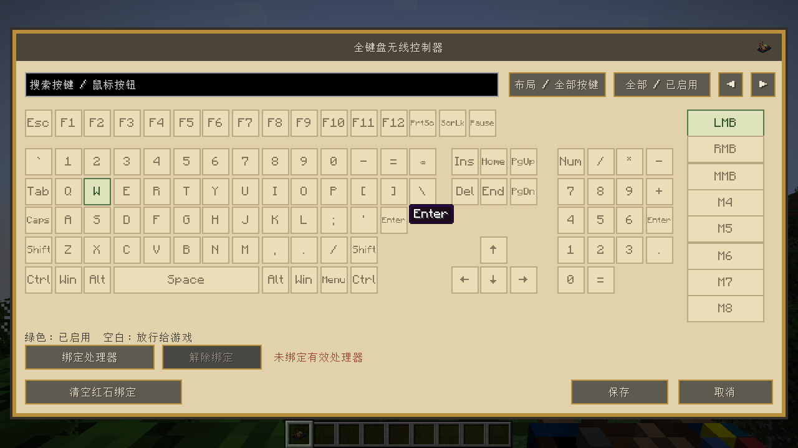
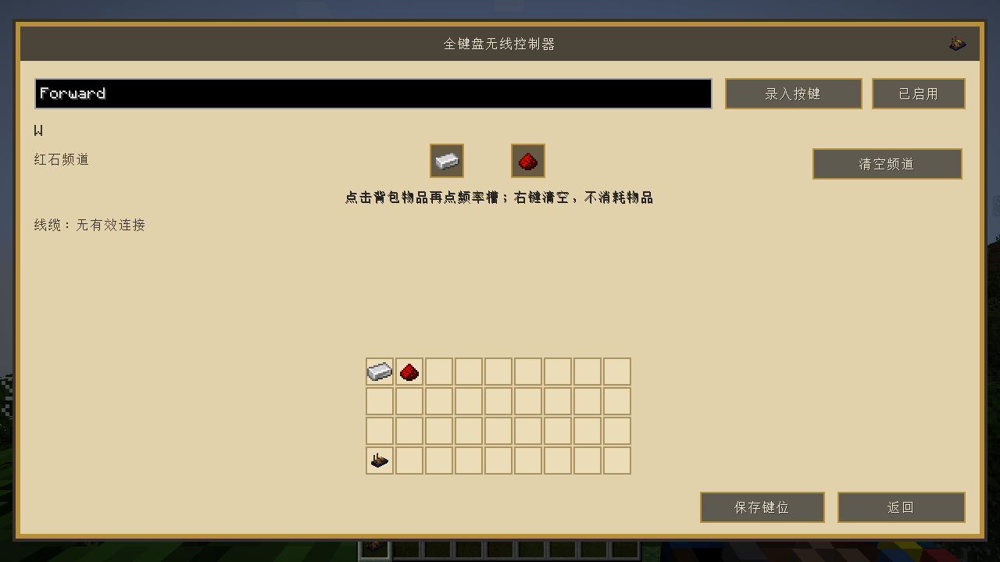
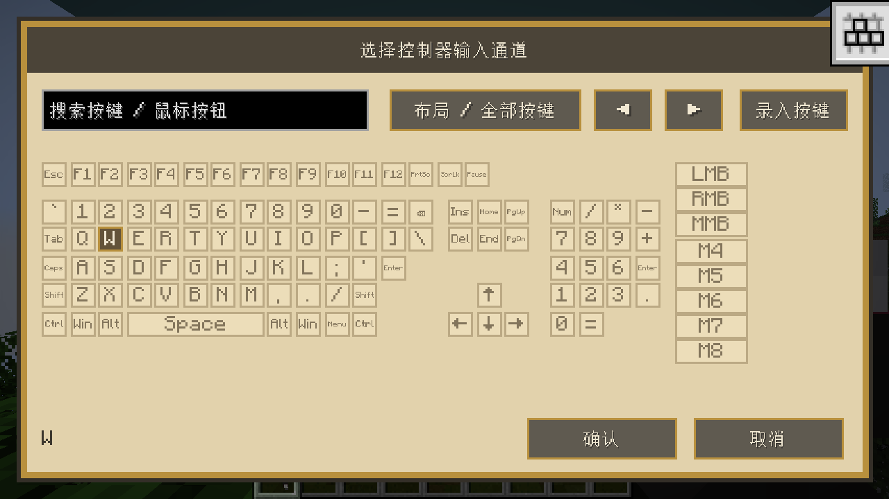

# 全键盘无线控制器交付说明

本文记录 0.9.0 的首次交付。当前 0.9.1 已改用紧凑界面、完整原版风格背包与直接右键终端绑定，使用方法以 [最新修订说明](WIRELESS_CONTROLLER_COMPACT_2026-10-12.md) 为准。

需求日期：2026-10-11；完成日期：2026-10-12。版本：0.9.0，Minecraft 1.21.1 / NeoForge 21.1.230。

发行包：`build/libs/create-fire-control-0.9.0.jar`。

## 使用

1. 在综合火控创造物品栏获取“全键盘无线控制器”，或用 Create 无线红石遥控器、两张黄铜板、两个精密构件合成。
2. 蹲下右键打开配置。点击键盘或鼠标区域的输入，进入二级菜单；填写用途名称，点击背包物品，再点击两个虚拟频道槽。物品不会消耗，右键槽位可清空。
3. 保存键位后返回主界面，再点击“保存”写入控制器。直接返回或取消不会保存草稿。主界面支持搜索、全部按键列表与已启用筛选，悬停显示用途及输出类型。
4. 普通右键激活，按住已配置输入输出 15，松开输出 0；Tab 退出并释放输出。鼠标移动保留视角转动。

同一输入可以同时发送无线红石和线缆信号。只有有效用途才接管输入：未绑定的 W、E 或鼠标左键仍执行游戏操作；只有名称、关闭的红石绑定、空处理器或未完成接线的通道都不会抢键。输入被接管时优先于原版按键、旧遥控器及本模组旧输入轮询。

Tab 保留为退出键。主键盘、小键盘和左右修饰键分别识别；鼠标左、右、中、侧键以及 GLFW 的其余按钮拥有独立通道。操作系统拦截的按键无法传入游戏；本版不包含滚轮、组合键与模拟轴输出。

## 线缆控制

Drive By Wire 是可选集成，验证版本为 0.3.0。没有安装时遥控器仍可发送无线红石，处理器不进入创造物品栏和配方，相关线缆 UI 隐藏。不要求安装打字机线缆附属。

安装后，“无线控制器信号处理器”出现在 Drive By Wire 的创造物品栏，也可用精密构件、两张黄铜板、黄铜机壳和无线红石收发器合成。

1. 在控制器配置中点击“绑定处理器”，手持控制器右键目标处理器完成配对。此动作保存当前红石草稿。
2. 手持线缆右键选中处理器，按 **H** 打开选键 UI，点击输入或使用“录入按键”，再确认。
3. 关闭 UI 后右键目标设备完成接线。确认通道本身不会创建线路；完成有效连接后该输入才会启用。

H 可以在 Minecraft 按键设置的“机械动力:先进火控”分类下修改。只有手持线缆且选中该处理器时，快捷键才取得优先级；即使 H 与背包键冲突，也会打开选键 UI。打开动作不会将 H 自动设为通道，取消保留原通道。

解除处理器绑定立即保存解绑结果，并保留界面中的其他未保存草稿。清空红石绑定不会删除线缆线路。同一处理器在激活时拒绝另一名玩家覆盖当前会话。

## 模型与界面

安装高级遥控器 1.2.7 时委托它的原模型渲染器；未安装时委托 Create 普通遥控器模型。发行包没有打包第三方模型贴图或模组类。

界面使用综合火控自身的黄铜边框、米色面板和深棕标题栏，自行实现两物品频道槽、键位二级菜单和线缆选键。小窗口编辑页使用背包分页。

## 验收范围

开发环境为 Create 6.0.10、Sable 2.0.6、航空学/Simulated 1.3.2。

- `testWirelessControllerInputs`：键鼠通道区分、未配置放行、多输入并发、激活点击屏障、绑定变化和退出清理通过。
- 无线控及有线控两次实际服务端验收均为 `PASS`：真实 Create 无线网络输出、未知及未启用输入过滤、真实线控侧键输出、拆线放行、空处理器、同位置替换身份和退出归零。
- 实际客户端验收为 `PASS`：经过 Mixin 的键盘/鼠标分发，有效 W 不移动、有效左键不攻击、未配置 E 进入原版按键队列、Tab 退出、H 冲突优先、打开 H 保留原通道，以及解绑刷新时配置草稿保留。
- 中文 1280×720 截图检查覆盖主界面、二级菜单、小窗口背包分页、选键 UI 与高级遥控器模型。
- `build --offline -PcharacterizeCarrierHold=true` 完成，最后的 `testWirelessControllerInputs assemble --offline` 通过。仓库已有稳定器自由偏心重载精度失败仍按 characterization 记录；此结果不代表该项严格精度通过。

原始结果文件保存在 `run/controller-no-wire/server/controller-integration-result.txt`、`run/controller-wire/server/controller-integration-result.txt` 和 `run/controller-client/client/controller-client-result.txt`。具体启动参数见 [开发依赖说明](DEPENDENCIES.md)。测试 fixture 不进入发行包。

终端地址使用现有 Sable `BindingRef`，并通过持久 UUID 校验替换及加载后的重定位。此次服务端验收包含同位置替换；实际载具的结构重建、蓝图复制与移动后多用户接管仍需在具体载具上进行联调。

## 后续扩展

`ControllerActionRegistry.Provider` 提供有效输入查询与按下/释放分发，供火控计算机直接映射接入。本版尚未注册具体火控动作，因此界面不会显示无效的火控绑定按钮。
