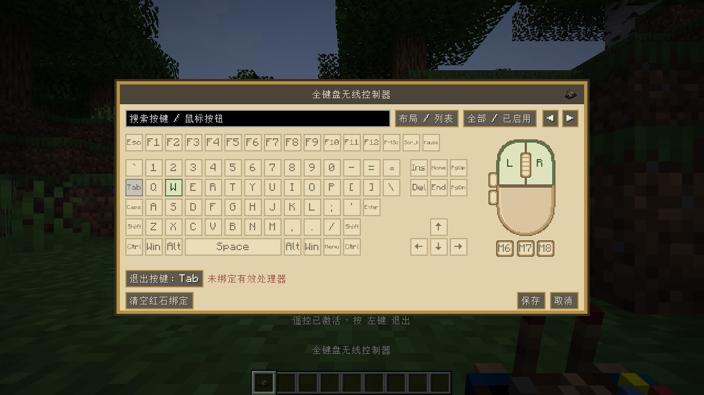
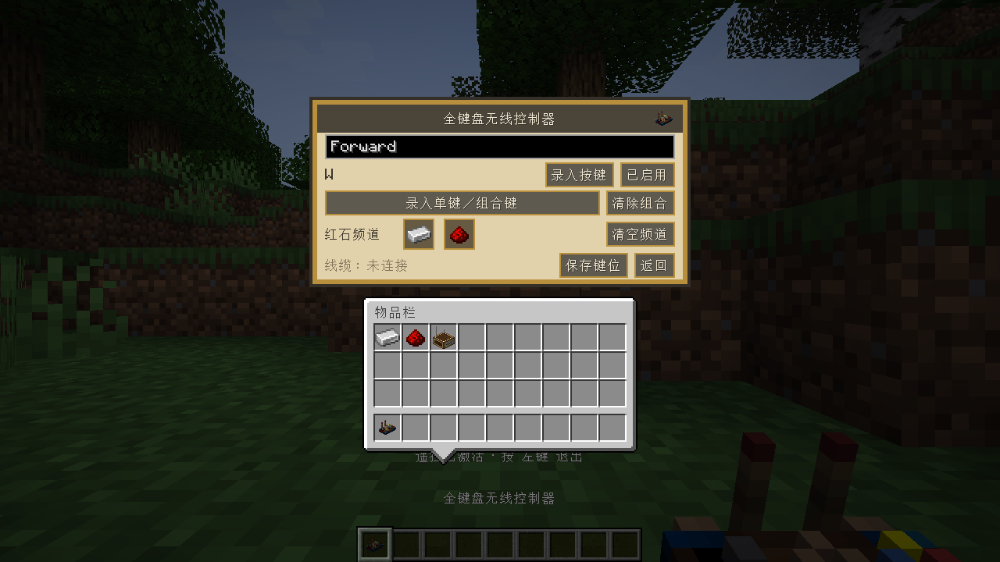
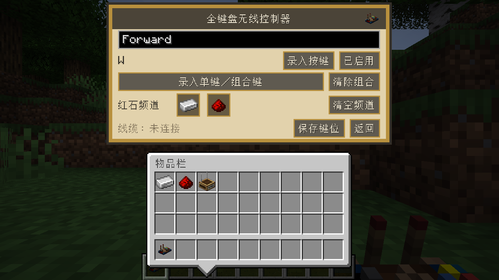

# 无线控制器紧凑界面与终端绑定修订

版本：9.0，日期：2026-10-12。适用 Minecraft 1.21.1 / NeoForge。

产物：`build/libs/create-fire-control-9.0.jar`。

## 按键音效与版本约定

每个有效键盘或鼠标控制输入在首次按下时，复用航空学 / Simulated 的 `LINKED_TYPEWRITER_TAP` 音效，音量与音高均为 1.0，播放位置为本地玩家。长按重复事件、释放、退出键、未绑定输入与激活时等待释放的输入不播放。版本号按用户要求固定为 `9.0`，后续不自行递增。

## 鼠标位置修正

两个侧键整体上移至标注区域；滚轮与左右按钮分隔线按外壳像素中轴居中，避免缩放取整造成偏移。鼠标绘制与点击检测共用像素边界，侧键优先于重叠的左键区域响应。

本轮重新执行输入验收、离线构建与客户端实机验收，并更新下方截图。服务端逻辑未改动，下文服务端验收记录来自 0.9.2。

## 0.9.2 界面与绑定修改

- 主界面与线缆选键页缩小面板，移除小键盘区。鼠标采用更宽、更短的黄铜与米色外壳，按钮边框、滚轮刻纹与侧键分别绘制；左、右、中键及两个侧键直接对应图示，额外鼠标按钮位于轮廓下方。
- 删除“绿色：已启用／空白：放行给游戏”和频率虚拟槽操作提示。主界面收短 12 像素，移除“解除绑定”，该行改为退出按键设置。
- 退出按键默认 Tab。点击该按钮后按键，或点击上方键鼠图选择退出输入；再次点击按钮可取消录入。退出键随每个控制器保存，图示与列表显示为灰色，不能编辑为控制输入或录入为红石键位。服务端排除当前退出键的无线红石、线缆和功能输出；已有频道配置保留，改变退出键后可重新使用。
- 按钮高度 16，宽度为当前语言文字宽度加少量边距；搜索、状态、翻页与确认紧凑排列。
- 键位编辑页上方为 244×116 的综合火控配置面板，“保存键位／返回”下方增加 6 像素空间；下方使用与航空学打字机相同的 Create 原版风格背包背景。三排背包与快捷栏完整显示，取消背包分页；槽位使用标准 18 格间距，显示物品数量及悬停反馈。
- 红石频道保留两件物品设定频率的方式。点击背包物品再点击虚拟槽，不消耗物品；右键虚拟槽清空。
- 手持控制器直接右键信号处理器完成绑定，与线控的高级无线红石遥控器一致。移除“绑定处理器”按钮和绑定模式，绑定点击不会激活输出；蹲下右键其他位置仍打开配置。控制状态先按设置的退出键退出，再进行直接绑定。
- 处理器在模型烘焙时直接使用 Drive By Wire 的 `controller_hub` 原方块及物品模型，选择和碰撞箱与原终端一致。处理器仅加入线控创造标签页，从综合火控标签页移除。

## 操作

右键激活、默认 Tab 退出、蹲下右键配置。点击键盘或鼠标区域进入编辑页，保存键位后返回主界面，再保存整个控制器配置；退出按键的修改也需要保存整个控制器配置。改成其他退出键后，Tab 可以绑定控制输出。退出事件优先于游戏按键，按住退出键时会抑制重复事件，释放后恢复正常游戏输入。

线缆使用顺序为：手持控制器右键处理器绑定 → 手持线缆右键选中处理器 → 按 H 选择并确认输入 → 右键目标设备完成接线。H 仍可在游戏设置中修改，仅在选中处理器的线缆上下文取得优先级。

未安装线控时遥控器及无线红石仍可用，处理器不显示于创造标签页、配方及线缆 UI。模型兼容层也不加载线控类，保留无依赖情况下的资源回退；没有复制或打包线控模型贴图和模组类。

## 验证

服务端验收覆盖退出键配置的会话校验与保存、非法退出键回退到 Tab、当前退出键不能触发红石/线缆/未来动作、原 Tab 可以真实输出及停止清理，并回归直接右键配对、半高碰撞箱、线控侧键及拆线放行；有、无线控两种环境分别生成 `PASS`。

客户端验收覆盖退出键录入、灰色按键不可编辑、改键后原 Tab 可录入与输出、键盘和鼠标退出均优先于原版冲突绑定、退出键释放屏障、服务器刷新保留退出键草稿，并回归原终端模型、创造标签页、背包频率选择、不消耗物品和 H 冲突。中文 1280×720、界面缩放 2 和 3 的实机截图经过检查。

本轮执行 `testWirelessControllerInputs assemble --offline`。启动参数仍见 [开发依赖说明](DEPENDENCIES.md)，fixture 不进入发行包。火控动作映射与双键组合现已接通，见 [分类按键与组合键说明](FIRE_CONTROL_INPUTS_2026-10-12.md)。
